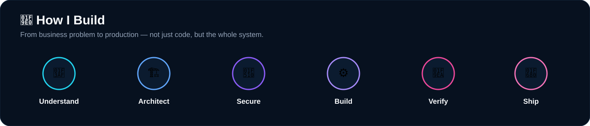

 

 

 

 

## ⚡ Engineering Stack

  

 

 

&nbsp;

 

 

## 📊 GitHub Activity

  

  

 

## 🐍 Contribution Animation

<picture>
  <source media="(prefers-color-scheme: dark)" srcset="https://raw.githubusercontent.com/Chaitu381/Chaitu381/output/github-contribution-grid-snake-dark.svg">
  <source media="(prefers-color-scheme: light)" srcset="https://raw.githubusercontent.com/Chaitu381/Chaitu381/output/github-contribution-grid-snake.svg">
  
</picture>

 

## 🎯 Current Focus

| Engineering Area | What I'm working on |
|---|---|
| ☕ **Java Backend** | Spring Boot, Spring Security, REST APIs, service design |
| ⚛️ **Full Stack** | React, TypeScript, API integration, production UI |
| 🔐 **Application Security** | Authentication, JWT, RBAC, permissions |
| 🗄️ **Data** | MySQL, PostgreSQL, schema design, migrations |
| 🏗️ **Architecture** | Modular systems, service boundaries, scalability |
| 📡 **IoT** | Raspberry Pi, ESP32, MQTT, connected systems |
| 🚀 **Production** | Docker, Linux, CI/CD, deployment, reliability |

 

  

