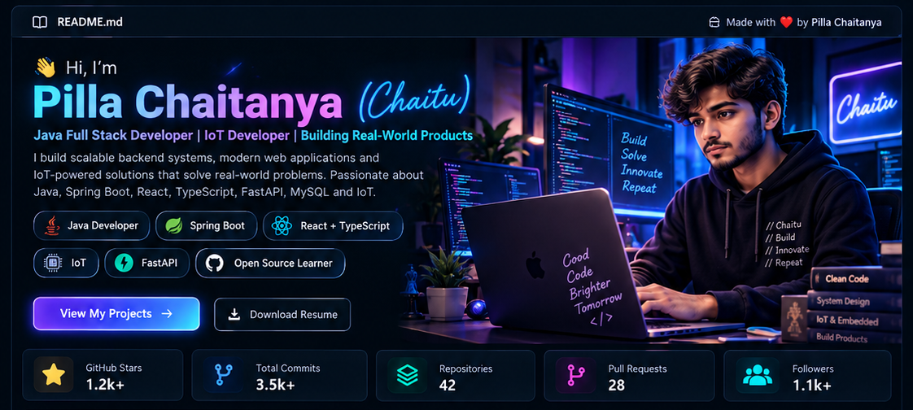
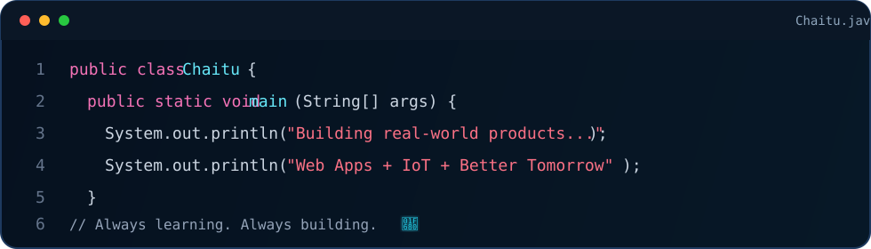
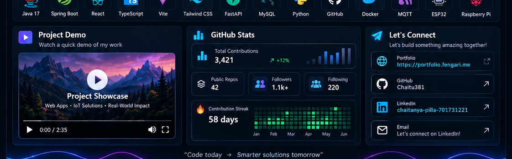

<div align="center">

<a href="https://portfolio.fengari.me">
  
</a>

<br/>


<br/>

<a href="https://portfolio.fengari.me"></a>
<a href="https://github.com/Chaitu381"></a>
<a href="https://github.com/Chaitu381?tab=repositories"></a>
<a href="https://www.linkedin.com/in/chaitanya-pilla-701731221/"></a>
<a href="mailto:chaitu38192021@gmail.com"></a>

<br/><br/>


</div>

---

## 👨‍💻 About Me

<table>
<tr>
<td width="53%" valign="top">

I'm **Pilla Chaitanya (Chaitu)** — a developer focused on building complete, production-oriented software across backend systems, modern web applications and IoT-connected products.

I work mainly with **Java, Spring Boot, React, TypeScript, FastAPI, MySQL and Python**, with hands-on interest in authentication, role-based access, API design, deployment, device communication and maintainable system architecture.

- ☕ **Backend:** Java 17, Spring Boot, Spring Security, JPA/Hibernate
- ⚛️ **Frontend:** React, TypeScript, Vite, Tailwind CSS
- ⚡ **Python:** FastAPI, automation, analytics workflows
- 🗄️ **Data:** MySQL, PostgreSQL, relational schema design
- 📡 **IoT:** Raspberry Pi, ESP32, MQTT, connected systems
- 🚀 **Production:** Docker, GitHub, Linux, CI/CD and cloud deployment

**What I care about:** clean architecture, secure APIs, reliable integrations, sensible UX and shipping software that solves a real problem.

</td>
<td width="47%" valign="top">



</td>
</tr>
</table>

---

## ⭐ Featured Projects

<table>
<tr>
<td width="20%" valign="top">

### 🎓 ScholarLearn
Multi-institute learning platform for students, lecturers and administrators.

`Spring Boot` `React` `MySQL`

</td>
<td width="20%" valign="top">

### 💻 CodeConnect
Coding, assessment and secure execution workflows with analytics and evaluation.

`Java` `React` `APIs`

</td>
<td width="20%" valign="top">

### ❤️ LOH Connect
Campaign platform with WhatsApp → Email → SMS workflows, imports and delivery tracking.

`FastAPI` `React` `Redis`

</td>
<td width="20%" valign="top">

### 🍯 Boy Next Door Honey
Full-stack product and commerce experience with admin, media and order workflows.

`Spring Boot` `React`

</td>
<td width="20%" valign="top">

### 📡 Smart Bollard
IoT monitoring and remote-control platform connecting software with field hardware.

`IoT` `MQTT` `Raspberry Pi`

</td>
</tr>
</table>

<div align="center">

<a href="https://portfolio.fengari.me">
  
</a>
&nbsp;
<a href="https://github.com/Chaitu381?tab=repositories">
  
</a>

</div>

---

## 🧰 Tech Stack

<div align="center">

### Core


### Tools, Infrastructure & IoT


<br/>


</div>

---

## 🎬 Project Showcase

<div align="center">

<a href="https://portfolio.fengari.me">
  
</a>

**Click the showcase above to open my portfolio.**

> GitHub README pages do not support a fully interactive embedded video player reliably.  
> This design uses a clickable showcase card so the profile stays fast, clean and compatible.

</div>

---

## 📊 Live GitHub Analytics

<div align="center">

<picture>
  <source
    media="(prefers-color-scheme: dark)"
    srcset="https://github-readme-stats.vercel.app/api?username=Chaitu381&show_icons=true&hide_border=true&bg_color=07111F&title_color=38BDF8&icon_color=A78BFA&text_color=CBD5E1&ring_color=22D3EE&include_all_commits=true&count_private=true"
  />
  
</picture>

<picture>
  <source
    media="(prefers-color-scheme: dark)"
    srcset="https://github-readme-stats.vercel.app/api/top-langs/?username=Chaitu381&layout=compact&hide_border=true&bg_color=07111F&title_color=38BDF8&text_color=CBD5E1&langs_count=8"
  />
  
</picture>

<br/><br/>


<br/><br/>


</div>

---

## 🐍 Contribution Animation

<div align="center">

<picture>
  <source media="(prefers-color-scheme: dark)" srcset="https://raw.githubusercontent.com/Chaitu381/Chaitu381/output/github-contribution-grid-snake-dark.svg">
  <source media="(prefers-color-scheme: light)" srcset="https://raw.githubusercontent.com/Chaitu381/Chaitu381/output/github-contribution-grid-snake.svg">
  
</picture>

</div>

---

## 🧠 How I Build

```text
Business Goal
     │
     ▼
Architecture
     │
     ├───────────────┬────────────────┐
     ▼               ▼                ▼
 Security          APIs           Database
     │               │                │
     └───────────────┴────────────────┘
                     │
                     ▼
            Product Integration
                     │
                     ▼
              Test & Validate
                     │
                     ▼
                Production
```

<div align="center">

`Understand the problem` → `Design the system` → `Secure it` → `Build it` → `Test it` → `Ship it`

</div>

---

## 🎯 Current Engineering Focus

| Area | Focus |
|---|---|
| ☕ Java Backend | Spring Boot, Spring Security, REST APIs |
| ⚛️ Full Stack | React, TypeScript, API integration |
| 🔐 Security | Authentication, JWT, RBAC, authorization |
| 🗄️ Databases | MySQL, PostgreSQL, relational modeling |
| 🏗️ Architecture | Modular systems, service boundaries, scalability |
| 📡 IoT | Raspberry Pi, ESP32, MQTT, connected-device applications |
| 🚀 Production | Docker, Linux, deployment, CI/CD and reliability |

---

## 🤝 Connect With Me

<div align="center">

<a href="https://portfolio.fengari.me">
  
</a>

<a href="https://github.com/Chaitu381">
  
</a>

<a href="https://www.linkedin.com/in/chaitanya-pilla-701731221/">
  
</a>

<a href="mailto:chaitu38192021@gmail.com">
  
</a>

<br/><br/>

### `Build. Solve. Improve. Repeat.`

**Pilla Chaitanya (Chaitu)**  
Java Full Stack • Backend Engineering • IoT • Production Systems

</div>
