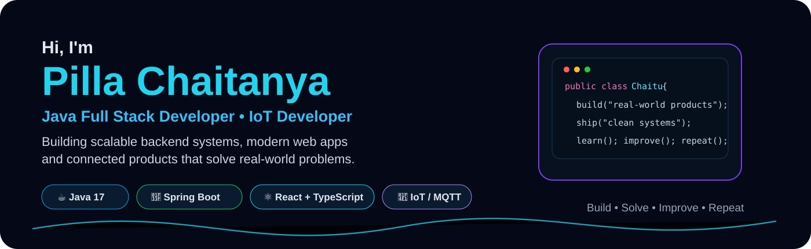
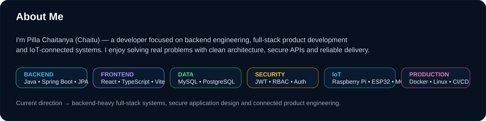
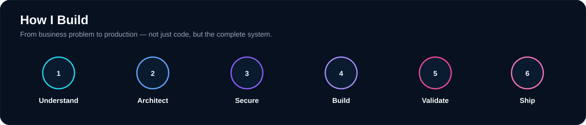

 

  

&nbsp;
&nbsp;
&nbsp;

  

 

 

## Tech Stack

  

 

 
&nbsp;

 

 

## GitHub Snapshot

  

  

  

 

## Contribution Animation

> After pushing this README, run the GitHub Action once to generate the live snake animation.

 

## Current Focus

| Engineering Area | What I'm working on |
|---|---|
| **Java Backend** | Spring Boot, Spring Security, REST APIs, service design |
| **Full Stack** | React, TypeScript, API integration, production UI |
| **Application Security** | Authentication, JWT, RBAC, permissions |
| **Data** | MySQL, PostgreSQL, schema design, migrations |
| **Architecture** | Modular systems, service boundaries, scalability |
| **IoT** | Raspberry Pi, ESP32, MQTT, connected systems |
| **Production** | Docker, Linux, CI/CD, deployment, reliability |

 

&nbsp;
&nbsp;
&nbsp;

  

